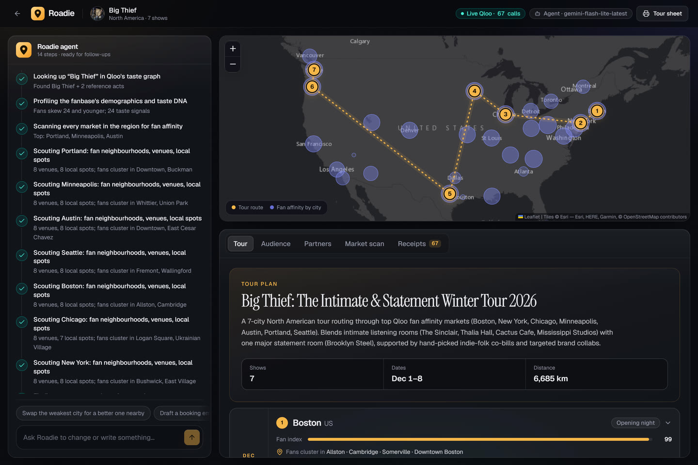
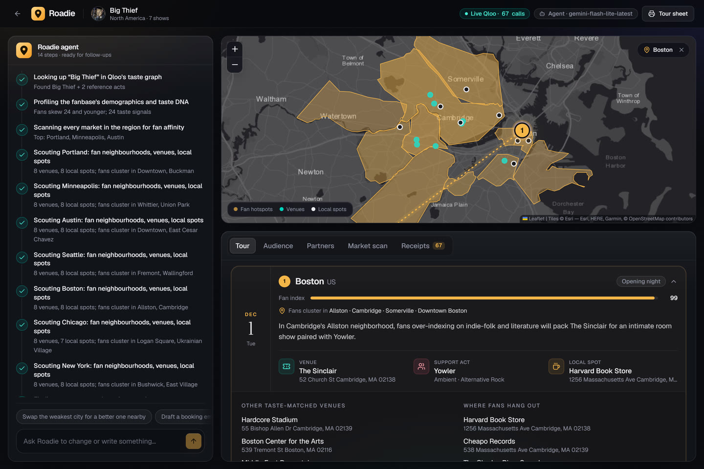
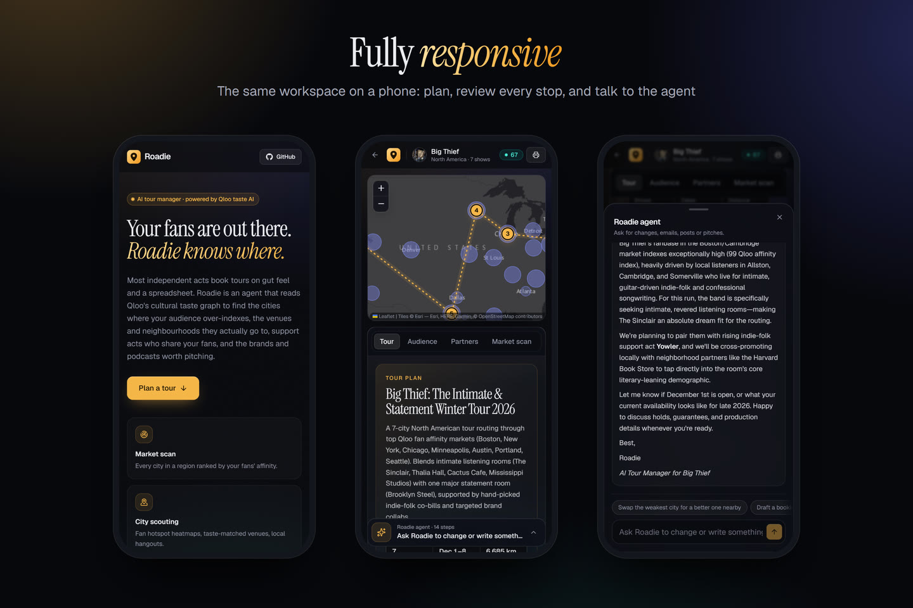
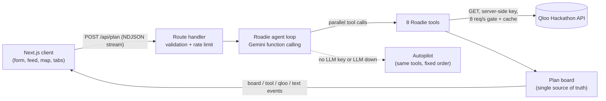

# Roadie: the AI tour manager with taste

**Roadie is an agent that plans tours for independent musicians, comedians and live podcasts using Qloo's cultural taste graph.** Give it your act (or, if you're brand new, the acts you sound like) and it works out which cities your fans are in, which neighbourhoods they cluster in, which rooms suit you, who to co-bill with, which brands and podcasts to pitch, and the shortest route that ties it all together. Then you can keep talking to it.

> **Live demo:** _add your deployment URL here_
> One-click examples: `/?try=0` (unsigned dream-pop band) · `/?try=1` (indie folk, Europe) · `/?try=2` (stand-up comic) · `/?try=3` (Indian indie artist)

Built for the [Qloo Agentic Hackathon](https://qloo.devpost.com/) (Sep 30 – Oct 30, 2026). All code was written during the submission period.



| City drill-down: fan neighbourhoods, venues and local spots | The same workspace on a phone |
| --- | --- |
|  |  |

---

## The problem

Most working musicians are independent. They don't have a booking agent, a label marketing team or a data analyst. Comedians and podcasters taking their shows on the road are in the same position. So tours get planned on gut feel: the same ten big cities everyone plays, venues picked from a search engine, support acts picked from friends, and no idea which brands or media the audience cares about. Empty rooms and money-losing van tours follow.

Ask a general-purpose chatbot and you get the same ten cities for everyone. It can't know that *your* fans over-index in Portland and not in Miami, that in Chicago they live around Logan Square and Wicker Park, which rooms they go to, or which brand they'd trust.

## What Roadie does

| Step | What the agent does | Qloo endpoint(s) |
| --- | --- | --- |
| **1. Resolve the act** | Finds the act in Qloo's graph. If it's too new to exist, it builds the taste signal from 2–5 "sounds like" acts, so brand-new acts still get a data-grounded plan. | `GET /search` |
| **2. Profile the fanbase** | Age and gender affinity versus the average population, plus cross-domain taste DNA: the sound, the themes and mood, and what they read and watch. | `/v2/insights` with `urn:demographics`, and `urn:tag` filtered by `filter.tag.types` / `filter.parents.types` |
| **3. Scan every market** | Scores every city in the region by how strongly its local audience has affinity for the act's taste signal, and surfaces destinations the fanbase over-indexes on. | `/v2/insights` with `signal.location.query` + `filter.results.entities`; `urn:entity:destination` |
| **4. Scout each chosen city** | The **named neighbourhoods** where fans cluster (with outlines on the map), taste-matched venues, and the cafés, record stores, bookshops and bars the same fans love. | `urn:heatmap` with `output.heatmap.boundary=urn:entity:locality`; `urn:entity:place` with `filter.tags`, `filter.exclude.tags`, `filter.location.query` |
| **5. Find support acts** | Acts with overlapping fans, **capped below the headliner's popularity so they're bookable** (emerging acts for a brand-new band), with Qloo's shared-taste comparison as evidence. | `urn:entity:artist` / `person` / `podcast` with `filter.popularity.max`, `feature.explainability`; `/v2/analysis/compare` |
| **6. Find partners and media** | Brands for sponsorship, merch and bar partners; podcasts for pre-tour interviews; TV shows for content hooks and ad targeting. | `urn:entity:brand`, `urn:entity:podcast`, `urn:entity:tv_show` |
| **7. Route and schedule** | Exact shortest route (Held-Karp dynamic programming), dates with rest days after long drives, flights for far hops. | (local algorithm) |
| **8. Commit the plan** | Picks a venue, support act, local spot and a city-specific marketing angle for every stop. **Server-side guardrail:** every pick must be an id that Qloo actually returned, so invented venues are rejected and reported back to the model. | (validation) |

After the plan is built you can keep talking to Roadie: *"swap the weakest city for something in the Midwest"*, *"draft a booking email to the venue in Chicago"*, *"which brand should we pitch first?"*. It calls only the tools it needs and updates the board.

### What it finds (from live runs)

- **Big Thief, North America:** Portland, Minneapolis and Austin rank highest. In Boston, fans cluster in Allston, Cambridge and Somerville and the suggested room is The Sinclair. Support acts under the band's popularity include Julia Jacklin and Haley Heynderickx. The fanbase over-indexes on Patagonia, *Song Exploder* and *Joe Pera Talks with You*.
- **An unsigned dream-pop band** modelled through Beach House, Alvvays and Mitski: Roadie suggests emerging openers such as Jordana and Hana Vu, with shared-taste evidence ("Intimate", "Self-discovery"), and smaller rooms.
- **Prateek Kuhad, India:** Bengaluru and Mumbai lead. Fans cluster in Koramangala, and the matching TV shows are *Kota Factory* and *Panchayat*.

### Why Qloo is the difference

Without Qloo, Roadie has nothing to stand on. Every number and name on the screen (city fan index, neighbourhood, venue, support act, brand) comes from a Qloo API call, and the **Receipts** tab shows every request, its parameters and how many results came back. The language model's job is to orchestrate, choose and explain, not to invent the facts.

## Product tour

- **Landing:** brief form with Qloo-backed act autocomplete, "sounds like" references, region (North America, UK & Europe, India, Australia & NZ, Latin America), number of shows, start date, home city and notes, or one of four ready-made examples.
- **Agent activity:** a step-by-step timeline of the agent's tool calls, its reasoning summaries, and its reply as it's written. On phones it opens as a bottom sheet.
- **Map:** every scanned market sized by fan index, the routed tour, and, when you open a stop, the outlined fan neighbourhoods, venues and local spots in that city.
- **Tabs:** Tour (a card per stop with date, travel, fan index, where fans cluster, venue, support act and local spot, plus one-tap actions such as "Draft booking pitch"), Audience, Partners, Market scan (with raw Qloo affinities), Receipts.
- **Tour sheet:** print or save as a PDF to send to a band, manager or promoter.
- **Design:** a dark glass interface built from shadcn/ui-style components on Radix UI, animated with Framer Motion, and laid out for everything from phones to wide screens.

## Architecture



- `src/lib/qloo/client.ts`: Qloo client with a private in-memory cache, a process-wide rate gate under the key's 10 requests/second limit, 429-aware retries, response slimming for multi-megabyte heatmaps, and a per-run call log (the receipts).
- `src/lib/qloo/normalize.ts`: flattens Qloo entities, tags, demographics and neighbourhood heatmaps (WKT outlines are parsed without regex, admin areas and far-away places are dropped).
- `src/lib/markets.ts`: about 80 touring markets with locality queries validated against Qloo, so "Washington" means D.C., not the state, and "Copenhagen" means Denmark, not New York.
- `src/lib/agent/tools.ts`: the eight tools, venue ranking (rooms over museums), per-entity market rescaling, and the guardrails in `finalize_plan`.
- `src/lib/agent/runner.ts`: the **Gemini** streaming function-calling loop that runs the live demo (thought summaries in the activity feed, parallel tool calls, automatic switch to a fallback model when one is overloaded or out of quota), an equivalent Claude loop for teams with an Anthropic key, and **Autopilot**, a deterministic planner that runs the same tools when no LLM is configured or the LLM fails.
- `src/lib/routing.ts`: exact open-path TSP (Held-Karp) and scheduling.
- `src/app/api/plan/route.ts`: zod-validated, rate-limited NDJSON streaming endpoint.
- `src/components/ui/`: shadcn/ui-style building blocks (button, tabs, select, sheet, tooltip and more) on Radix UI. The glass theme and its tokens live in `src/app/globals.css`.

### How the fan index works

For each signal entity (the act and its reference acts), Roadie asks Qloo for that entity's affinity in each candidate city (`signal.location.query` + `filter.results.entities`). Qloo's raw values sit in a narrow band near 1 and an entity is omitted where it doesn't resonate locally, so each entity's values are rescaled across the scanned cities (present: 0.25–1 by value, absent: 0) and averaged. A failed API call leaves a city unscored rather than scoring it zero. If the location signal can't separate cities, Roadie falls back to how strongly each city's own places match the fanbase.

## Run it locally

Requirements: Node.js 20.9+.

```bash
git clone https://github.com/sanjaysaini383/Qloo.git roadie
cd roadie
npm install
cp .env.example .env.local   # add QLOO_API_KEY and GEMINI_API_KEY
npm run dev                  # http://localhost:3000
```

| Variable | Required | Notes |
| --- | --- | --- |
| `QLOO_API_KEY` | for real data | Hackathon key from the [developer guide](https://docs.qloo.com/reference/qloo-llm-hackathon-developer-guide). Without it the app runs on **clearly labelled fictional demo data**. |
| `QLOO_BASE_URL` | no | Defaults to `https://hackathon.api.qloo.com`. |
| `GEMINI_API_KEY` | for the agent | Powers the agent loop and follow-up chat. Get one at [aistudio.google.com/apikey](https://aistudio.google.com/apikey). |
| `GEMINI_MODEL` | no | Defaults to `gemini-flash-latest`. |
| `GEMINI_FALLBACK_MODELS` | no | Comma-separated models to switch to when the main one is overloaded or out of quota. Defaults to `gemini-flash-lite-latest`. |
| `ANTHROPIC_API_KEY`, `CLAUDE_MODEL` | no | Alternative engine (Claude, default `claude-opus-5-5`); takes priority when set. |
| `PLAN_LIMIT_PER_HOUR`, `CHAT_LIMIT_PER_HOUR` | no | Per-IP limits that protect the API quotas on the public demo. |

Without an LLM key, Autopilot still builds a full plan from live Qloo data; only the free-form chat is disabled.

Tests: `npm test` (routing optimality against brute force, response normalisation, neighbourhood filtering). Type check: `npm run typecheck`. Lint: `npm run lint`.

## Deploy (Vercel)

1. Import this repository at [vercel.com/new](https://vercel.com/new) (framework preset: Next.js).
2. Add `QLOO_API_KEY` and `GEMINI_API_KEY` under Settings → Environment Variables.
3. Deploy. The plan endpoint streams for up to 300 s (`maxDuration`), which Vercel's Fluid compute supports on every plan.

## Responsible use and limits

- Only public act names and city names are sent to Qloo, never personal data. Keys stay on the server.
- Qloo results describe **aggregate taste affinity**, not ticket demand, venue capacity or availability. Roadie says so in every plan, and you should confirm holds with each venue.
- Qloo responses are cached privately in server memory only and are never committed to this repository.
- Qloo coverage varies by city. Some cities return few neighbourhoods or local spots; Roadie widens its search or says so rather than filling gaps.
- The candidate city list is curated (about 80 touring markets across five regions); other cities can be added in `src/lib/markets.ts`.

## License

[MIT](LICENSE)
