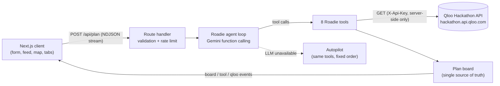

# Roadie: the AI tour manager with taste

**Roadie is an agent that plans tours for independent musicians, comedians and live podcasts using Qloo's cultural taste graph.** Give it your act (or, if you're brand new, the acts you sound like) and it works out where your fans actually are, which venues and neighbourhoods they go to, who to co-bill with, which brands and podcasts to pitch, and the travel-optimised route that ties it all together. Then you can keep talking to it.

> **Live demo:** _add your deployment URL here_
> One-click examples: `/?try=0` (unsigned dream-pop band) · `/?try=1` (indie folk, Europe) · `/?try=2` (stand-up comic) · `/?try=3` (Indian indie artist)

Built for the [Qloo Agentic Hackathon](https://qloo.devpost.com/) (Sep 30 – Oct 30, 2026). All code was written during the submission period.

---

## The problem

Most working musicians are independent. They don't have a booking agent, a label marketing team or a data analyst. Comedians and podcasters taking their shows on the road are in the same position. So tours get planned on gut feel: the same ten big cities everyone plays, venues picked from a Google search, support acts picked from friends, and no idea which brands or media the audience cares about. Empty rooms and money-losing van tours follow.

Ask a general-purpose chatbot and you get the same ten cities for everyone. It has no idea that *your* fans over-index in Minneapolis and not in Miami, which rooms they go to, or which brand they'd trust.

## What Roadie does

| Step | What the agent does | Qloo endpoint(s) |
| --- | --- | --- |
| **1. Resolve the act** | Finds the act in Qloo's graph. If it's too new to exist, it builds the taste signal from 2–5 "sounds like" acts, so brand-new acts still get a data-grounded plan. | `GET /search` |
| **2. Profile the fanbase** | Age and gender affinity versus the average population, plus cross-domain "taste DNA" tags. | `GET /v2/insights` with `filter.type=urn:demographics` and `filter.type=urn:tag` |
| **3. Scan every market** | Scores every city in the region by how strongly its audience has affinity for the act's taste signal, and surfaces destinations the fanbase over-indexes on. | `GET /v2/insights` with `signal.location.query` + `filter.results.entities`, and `filter.type=urn:entity:destination` |
| **4. Scout each chosen city** | Fan-hotspot heatmap, taste-matched venues (live music / comedy / theatre tags), and local spots the same fans love for meet-ups, content and flyering. | `filter.type=urn:heatmap`, `urn:entity:place` with `filter.tags` and `filter.location.query`, `GET /v2/tags` |
| **5. Find support acts** | Acts with overlapping fans, **capped at a popularity ceiling so they're actually bookable**, plus Qloo's shared-taste comparison. | `urn:entity:artist` / `person` / `podcast` with `filter.popularity.max` and `feature.explainability`, `GET /v2/analysis/compare` |
| **6. Find partners and media** | Brands for sponsorship, merch and bar partners; podcasts for pre-tour interviews; TV shows for content hooks and ad targeting. | `urn:entity:brand`, `urn:entity:podcast`, `urn:entity:tv_show` |
| **7. Route and schedule** | Exact shortest route (Held-Karp dynamic programming), dates with rest days after long drives, flights for far hops. | (local algorithm) |
| **8. Commit the plan** | Picks a venue, support act, local spot and a city-specific marketing angle for every stop. **Server-side guardrail:** every pick must be an id that Qloo actually returned, so hallucinated venues are rejected. | (validation) |

After the plan is built you can keep talking to Roadie: *"swap the weakest city for something in the Midwest"*, *"draft a booking email to the venue in Chicago"*, *"which brand should we pitch first?"*. It re-runs only the tools it needs and updates the board.

### Why Qloo is the difference

Without Qloo, Roadie has nothing to stand on. Every number on the screen (city affinity, venue match, demographic skew, brand overlap) comes from a Qloo API call, and the **Receipts** tab shows every request, its parameters and how many results came back. The LLM's job is to orchestrate, choose and explain, never to invent the facts.

## Product tour

- **Landing:** brief form with Qloo-backed act autocomplete, "sounds like" references, region (North America, UK & Europe, India, Australia & NZ, Latin America), number of shows, start date, home city and notes.
- **Agent activity:** live stream of the agent's reasoning and tool calls.
- **Map:** every scanned market sized by fan affinity, the routed tour, and, when you open a stop, the fan hotspots, venues and local spots in that city.
- **Tabs:** Tour (ticket-stub itinerary), Audience, Partners, Market scan, Receipts.
- **Tour sheet:** print or save as a PDF to send to a band, manager or promoter.

## Architecture



- `src/lib/qloo/client.ts`: Qloo client with a private in-memory cache, bounded retries on 429/5xx, a concurrency limit and a per-run call log (the receipts).
- `src/lib/qloo/normalize.ts`: flattens Qloo entity, tag, heatmap and demographics responses.
- `src/lib/agent/tools.ts`: the eight tools and the guardrails in `finalize_plan`.
- `src/lib/agent/runner.ts`: the Gemini tool-calling loop (parallel tool calls, follow-up chat with board context) and **Autopilot**, a deterministic fallback that runs the same tools if the LLM is down or not configured.
- `src/lib/routing.ts`: exact open-path TSP (Held-Karp) and scheduling.
- `src/app/api/plan/route.ts`: zod-validated, rate-limited NDJSON streaming endpoint.

## Run it locally

Requirements: Node.js 20.9+.

```bash
git clone https://github.com/sanjaysaini383/Qloo.git roadie
cd roadie
npm install
cp .env.example .env.local   # add QLOO_API_KEY and GEMINI_API_KEY
npm run dev                  # http://localhost:3000
```

| Variable | Required | Notes |
| --- | --- | --- |
| `QLOO_API_KEY` | for real data | Hackathon key from the [developer guide](https://docs.qloo.com/reference/qloo-llm-hackathon-developer-guide). Without it the app runs on **clearly labelled fictional demo data**. |
| `QLOO_BASE_URL` | no | Defaults to `https://hackathon.api.qloo.com`. |
| `GEMINI_API_KEY` | for the LLM agent | Free key from [Google AI Studio](https://aistudio.google.com/apikey). Without it, Autopilot builds the plan and chat is disabled. |
| `GEMINI_MODEL` | no | Defaults to `gemini-flash-latest`. |
| `PLAN_LIMIT_PER_HOUR`, `CHAT_LIMIT_PER_HOUR` | no | Per-IP limits that protect the API quota on the public demo. |

Tests: `npm test` (routing optimality against brute force, response normalisation). Type check: `npm run typecheck`. Lint: `npm run lint`.

## Deploy (Vercel)

1. Import this repository at [vercel.com/new](https://vercel.com/new) (framework preset: Next.js).
2. Add `QLOO_API_KEY` and `GEMINI_API_KEY` under Settings → Environment Variables.
3. Deploy. The plan endpoint streams for up to 300 s (`maxDuration`), which Vercel's Fluid compute supports on every plan.

## Responsible use and limits

- Only public act names and city names are sent to Qloo, never personal data. Keys stay on the server.
- Qloo results describe **aggregate taste affinity**, not ticket demand, venue capacity or availability. Roadie says so in every plan, and you should confirm holds with each venue.
- Qloo responses are cached privately in server memory only and are never committed to this repository.
- The candidate city list is curated (about 80 touring markets across five regions); other cities can be added in `src/lib/markets.ts`.

## License

[MIT](LICENSE)
